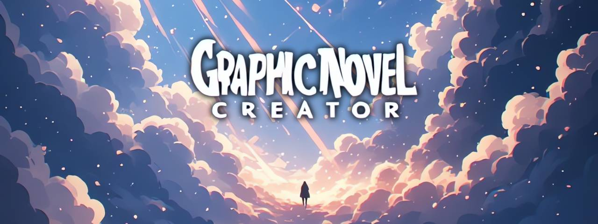
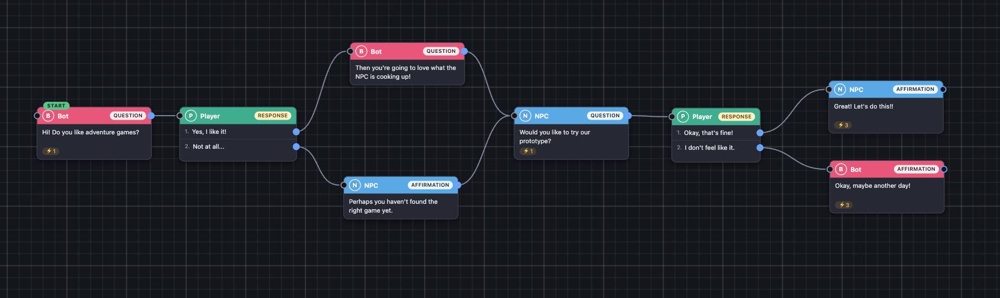

# Graphic Novel Creator

A visual editor for branching dialogue (graphic novels / chat-style stories). You build the story as a graph of draggable nodes in the browser and export it as JSON, ready to be read by a game engine (designed for Unity's `JsonUtility`).

- **Single file**: `GraphicNovel_Creator.html`. All CSS and JS are inline, no dependencies, no build step, no network access.
- Works opened directly from disk (`file://`) in Chrome, and on any static host (e.g. GitHub Pages).
- The UI is in European Portuguese but you can easily translate to English with the browser translator.

## Quick start

1. Open `GraphicNovel_Creator.html` in your browser (or load `exemplo.json` with **Importar .json** to see a small sample story).
2. Double-click on empty canvas to create a *speak* or *fala* (line of dialogue), or use **+ Fala** **+ Speak** / **+ Resposta** **+ Response**.
3. Drag from a node's output dot onto another node to link them.
4. **Exportar .json** downloads `story.json`.

Your work is saved automatically in the browser (`localStorage`). It is tied to the browser and the address you opened the page from, so use Export / Import to move a project elsewhere or to keep a backup.

## Concepts

| Concept | Meaning |
|---|---|
| **Characters** | Each has a stable `id`, a `name`, a colour and an optional 128×128 avatar. Exactly one character is the **player** (created automatically, fixed: you can edit its name, id, colour and avatar, but it cannot be changed or deleted). |
| **Fala** (line) | A character says something. Has a `kind` (`pergunta` / `afirmacao`, informational only), text, a list of events and one output (`next`). |
| **Resposta** (answer) | Always belongs to the player. Holds an ordered list of options; each option has its own text, events and output. A single option is valid. |
| **Events** | Free-form strings attached to a line or to an option (suggested convention: `som:porta`, `anim:ana:sorri`). Existing events are offered as autocomplete suggestions. The format is not validated. |
| **Start** | The node where the story begins (marked with an `INÍCIO`/`START` badge). |

Branches can converge: several nodes may link to the same target. A missing link means "end".



*The sample story (`exemplo.json`) open in the editor: lines by the bots, answers by the player, converging branches.*

## Editing

**Canvas**
- Pan: drag empty space (or middle mouse button). Zoom: mouse wheel (centred on the cursor), the `−`/`+` buttons, or **Ver tudo** to fit everything.
- Drag nodes by their header. Resize with the handle in the bottom-right corner (double-click the handle to return to automatic size).
- Double-click a node while zoomed out (< 70%) to smoothly zoom in on it.
- Click a link to select it, then press `Delete`/`Backspace` or click the ✕ on its midpoint to remove it.
- Drop a link on empty canvas to open a mini-menu (**+ Speak** / **+ Response**) that creates a new, already-linked node there. `Esc` or clicking elsewhere cancels and keeps the original link.

**Selected node = mini-editor.** A selected node expands so everything can be edited in place: change the character (click avatar/name), toggle the kind (click the badge), edit the text (`Enter` confirms, `Shift+Enter` new line, `Esc` cancels), add/remove event chips, set the start (⚑), and for answers edit, reorder (↑ ↓), remove (✕) options and open each option's events (⚙). The side panel's **Inspector** edits the same data and stays in sync.

**Side panel**: character list (player always first), and the Inspector.

**Soft validation** (never blocks anything): no start node, answer without options, missing character, links to non-existent nodes.

## JSON format

All fields are always emitted (empty strings `""` and empty arrays `[]` instead of `null`/omission) and only arrays are used, so it can be read with Unity's `JsonUtility`.

```json
{
  "version": 1,
  "start": "n_a1b2",
  "characters": [
    { "id": "player", "name": "You", "isPlayer": true,  "color": "#3fae8f", "avatar": "" },
    { "id": "ana",    "name": "Ana", "isPlayer": false, "color": "#e8577a", "avatar": "data:image/png;base64,..." }
  ],
  "nodes": [
    { "id": "n_a1b2", "type": "fala", "character": "ana", "kind": "pergunta",
      "text": "Do you like games?", "events": ["bot_pergunta"], "next": "n_c3d4",
      "options": [], "x": 60, "y": 160, "w": 0, "h": 0 },
    { "id": "n_c3d4", "type": "resposta", "character": "player", "kind": "", "text": "",
      "events": [], "next": "",
      "options": [
        { "text": "A lot!",   "to": "n_e5f6", "events": ["player_gosta"] },
        { "text": "Not much", "to": "",       "events": [] }
      ], "x": 360, "y": 140, "w": 0, "h": 0 }
  ]
}
```

- `characters[].id` is stable and is what nodes reference; changing a name never changes the id (editing the id updates all references). `avatar` is an embedded PNG data URL (128×128) or `""`.
- `type` is `"fala"` or `"resposta"`. Files using the older name `"escolha"` are converted to `"resposta"` on import.
- `kind` is `"pergunta"` / `"afirmacao"` for lines (informational, it does not decide behaviour) and `""` for answers.
- `next` (lines) and `options[].to` (answers) hold a target node id, or `""` for the end of the story.
- `x`, `y`, `w`, `h` are editor-only layout data (world coordinates; `0` for `w`/`h` means automatic size). Files without `w`/`h` import fine.
- Export → Import → Export gives an identical file.

### Import rules

Importing replaces the current project (after confirmation). The file is validated and normalised: exactly one player is guaranteed (one is created if missing; extra ones are dropped), answers are forced to the player, and links to non-existent nodes are removed. Clear error messages are shown for invalid files. You can also drag a `.json` file onto the canvas.

## Hosting on GitHub Pages

Nothing to build: publish the file in a repository and enable Pages. Pages serves `index.html` by default, so either rename `GraphicNovel_Creator.html` to `index.html` or link to it by its full name.

## Known limitations

- No undo/redo and no multi-selection.
- No touch/mobile support (designed for mouse and keyboard); only tested in Chrome.
- The mouse wheel always zooms, including on a trackpad.
- For answers, a custom height acts as a minimum, so options and their output dots are never hidden.
- Out of scope for now: background/node images, conditions and variables, zip export.

## Files

| File | Description |
|---|---|
| `GraphicNovel_Creator.html` | The editor (the whole application). |
| `exemplo.json` | Small sample story to import. |
| `README.md` | This file. |
| `LICENSE` | MIT license. |

## License

The source code (`GraphicNovel_Creator.html`) is released under the [MIT License](LICENSE).
Copyright (c) 2026 Guilherme Martins (guibot) https://guilhermemartins.net

Stories you create and export with the editor belong to you. 
The poster and screenshots in this repository are not covered by the MIT License.
